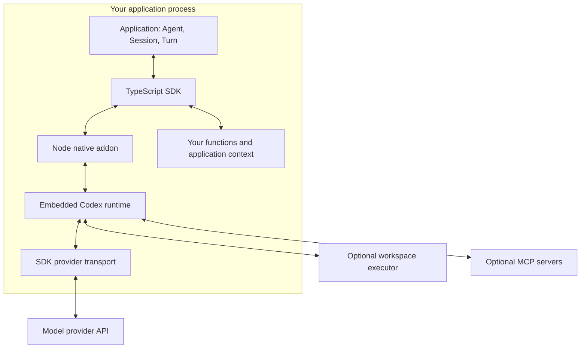
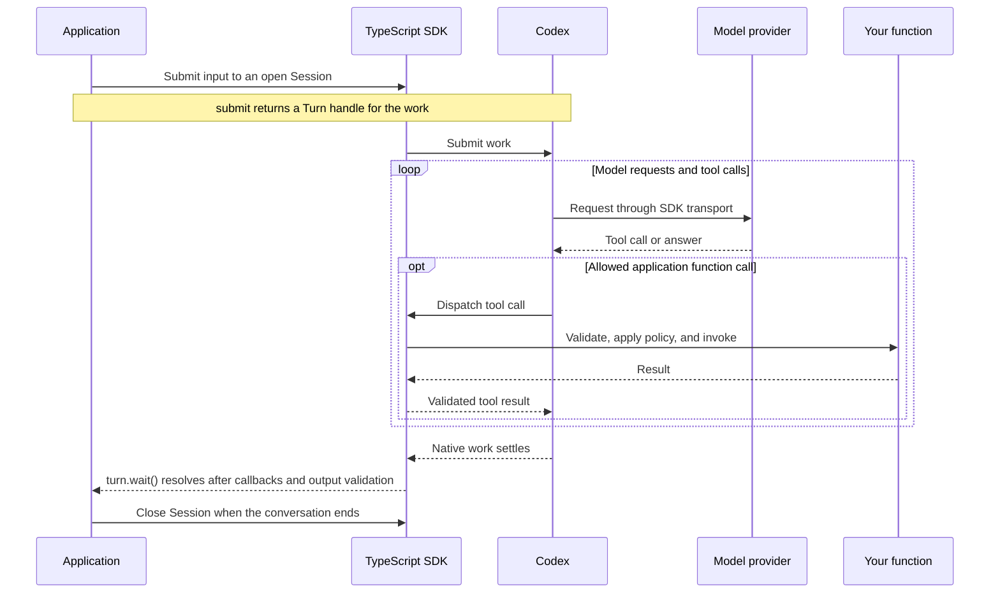

# Agents SDK architecture

The Agents SDK lets you build applications that use a model to reason and tools to act. In the native v1 design, the embedded Codex runtime coordinates the conversation: it requests model responses, routes tool calls, records results, and continues the task. You write TypeScript for your application, functions, and policies.

The **Codex harness** is the runtime around the model. The model chooses what to do next; the harness carries out those choices through the capabilities you allow. You get Codex's execution model through a library that runs in a process you control.

The native v1 API is under development. This page describes `feat/codex-harness`, which includes changes after the downloadable alpha. Use the [installation guide](installation.md) to match the documentation to your build. The [v0 comparison](#coming-from-v0) below uses stable [`@openai/agents@0.21.0`](https://github.com/openai/openai-agents-js/releases/tag/%40openai%2Fagents%400.21.0).

## What you can build

Start with your own function tools, then add [workspace execution](executors.md), [Model Context Protocol (MCP) services](mcp.md), or [native child agents](executors.md#native-child-agents) when a task needs them. An agent investigating a failed build can read source files and run a test in a selected workspace. It can query your build service through a function, then use the results to explain the failure. Codex coordinates the requests and tool results within that conversation.

Child agents can take on focused subtasks. [Programmatic tool calling](tools.md#programmatic-tool-calling), also called Code Mode, lets the model write JavaScript that calls and combines declared tools. Your functions still run in Node; the generated JavaScript runs in a separate bundled host. These optional features have model and configuration requirements.

The design puts the loop and native tools in Codex and keeps application integration in TypeScript. JavaScript and Python both build on Codex, while each SDK manages its own callbacks, validation, and resources. You can use this execution model for coding workflows or assistants that work with documents and business systems.

## Agent, Session, and Turn

| Object | What it means |
| --- | --- |
| `Agent` | A reusable declaration of instructions, tools, model settings, and output policy. Constructing one does not run a task. |
| `Session` | One live conversation, including its history, callbacks, and runtime resources. |
| `Turn` | A handle for submitted work, which can involve several model requests and tool calls. |

For one answer, `agent.run()` has been owning the request and its cleanup. For a conversation, open an explicit Session, submit input, and await `turn.wait()` for the result. Reusing an Agent creates no shared conversation by itself. The [greeting](../basic.ts) and [conversation](../conversation.ts) examples show both patterns.

## Where the code runs

Codex runs as an embedded Rust library in your application process. A Node native addon connects it to the TypeScript SDK. Model inference uses the configured provider; workspace operations can use a local or remote executor.

`@openai/agents` [exports the native API](../../../packages/agents/src/index.ts) from `@openai/agents-codex`. The [TypeScript runtime](../../../packages/agents-codex/src/runtime/public-agent.ts) manages declarations and callbacks; the [native binding](../../../packages/agents-codex/native/rust/lib.rs) connects it to Codex. An SDK-owned loopback HTTP/WebSocket transport connects native model requests to the provider and supports request editing.

Your functions execute with your Node application's permissions. An executor's filesystem and network policy applies to its operations, not to arbitrary function code in your process. You select the executor and storage services and control which credentials and permissions they receive.

## How a task progresses

Codex prepares a model request using the conversation and selected tools. A response can request a tool or provide an answer. For an application function, the SDK validates the call, applies its policy, invokes your callback if allowed, and returns the result to Codex. The next model request can use that result.

This sequence shows a successful function call:

`session.submit()` starts independent work and rejects while the Session is busy. Use the captured `turn.steer(input)` to add input to an active root, or `session.enqueue()` for separate queued work. See [Session controls](sessions.md).

Use `turn.wait()` to determine completion. [Observations](sessions.md) provide UI progress, but their bounded streams can have gaps. One native step ending does not establish that the logical Turn has finished, and independent child work can outlive the root result. [Interactions](interactions.md) are separate live requests through which you answer an approval or supply a result.

Stopping an observer leaves the work running. To stop work, cancel its Turn or close the Session and await cleanup. A running callback can delay cleanup, and cancellation cannot undo an action already performed. Configure [native telemetry](telemetry.md) separately to trace execution.

## Control tools, requests, and approvals

| You want to… | Use |
| --- | --- |
| Define available capabilities | Agent and [Session configuration](session-configuration.md) |
| Select eligible tools before a model step | [`beforeStep`](tools.md#select-tools-before-a-model-step) |
| Change the next model request | [`prepareRequest`](request-preparation.md), within its supported feature profile |
| Allow, deny, or transform a function call | Function [`before` and `after` policies](tools.md#inspect-or-change-tool-values) |
| Answer a pending approval or manual request | The issued [live interaction](interactions.md) |

**Application context** holds objects for your callbacks, such as a database client. **Canonical history** is Codex's accepted conversation record. The **model request** is the input prepared for one model call. Request editing changes that input without rewriting history or granting tool permissions. Context reaches the model only when your application includes it in instructions, input, or a tool result. You can also [compact context](session-configuration.md#context-compaction) to use a summary in later model requests.

## State and recovery

An ordinary Session lives in memory. Choose [storage](state.md#storage-and-recovery-tasks) before opening it. Portable checkpoints capture supported conversation state at eligible boundaries. Local profiles and application-owned stores retain state through their own backends. These modes support different tool combinations. Custom canonical storage excludes workspace executors, MCP, and child agents; consult the [store contract](session-store.md) before selecting it.

A checkpoint preserves conversation data, not current credentials, callback code, open connections, or workspace files. Restore needs a matching Codex revision and current tools and permissions. Keep the workspace separately when the next worker needs it. JavaScript and Python checkpoints are not interchangeable.

If a refund succeeds but the worker stops before recording its tool result, restoring history cannot tell you whether to issue it again. Verify the original action and reconcile its result before continuing. [Recovery guidance](recovery.md) explains this boundary; storage alone does not provide exactly-once business actions.

## Coming from v0

Stable v0 already provides an agent loop, tools, sessions, and tracing. The architectural change is who owns the loop and which execution model your application extends.

| Concern | Stable v0.21.0 | Native v1 design |
| --- | --- | --- |
| Execution loop | TypeScript `Runner` coordinates model calls and tools. | Embedded Codex coordinates native execution and history. |
| Starting work | `Runner.run(agent, input)` | `agent.run(input)` or an explicit Session and Turn |
| Session | A conversation-history store used by Runner | A live conversation with owned resources; storage is separate |
| Model integration | TypeScript `Model` and `ModelProvider` | `NativeProvider` has been using Responses for its built-in HTTP route; the matching source build has been accepting [application-supplied models](session-configuration.md#supply-an-application-model). |
| Saved work | Session history and `RunState` | Native checkpoints or configured storage, with their own restore contracts |

For a new application, start with the [native quickstart](../../../packages/agents-codex/README.md#run-an-agent). For an existing v0 workflow, prefer a direct [migration to native v1](migration.md). Port Agent declarations, tools, providers, execution, and state ownership together, then validate the application's behavior.

Use [v1 classic](../../../packages/agents/CLASSIC.md) only when a concrete dependency requires a staged migration. It retains the TypeScript Runner and its provider, guardrail, and handoff contracts. Classic is not deprecated now. Keep pending work on its original runtime; changing imports does not convert state or select another engine automatically.

The native package requires a supported platform and matching native binaries. Check [installation requirements](installation.md#requirements), then evaluate the tool, provider, and storage combinations your application needs.
